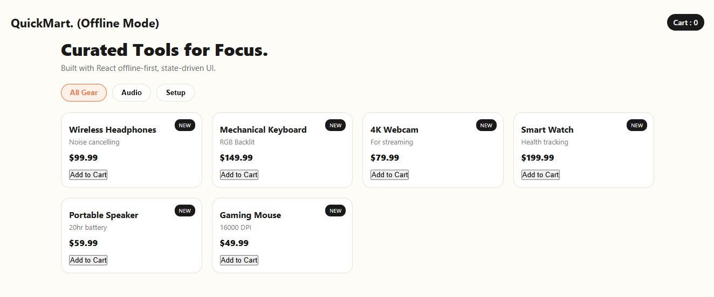

# Project: QuickMart React - E-Commerce UI (Offline Build) - v1

# About
A mini offline e-commerce UI built to learn React fundamentals without internet, JSX, or build tools.
It mimics a real store, the focus is not design, but understandinghow React works under the hood using custom React engine.

## Stack
- HTML5
- CSS3 (Flexbox + responsive)
- JavaScript (ES6)
- React (custom offline engine - no CDN)

## Features in v1
- [x] Component-based UI (ProductCard, App)
- [x] Props & reusable cards
- [x] useState hook for cart count
- [x] Category filter (All / Audio / Setup)
- [x] Add to Cart + localStorage persistence
- [x] Mobile responsive header (one-line fix)
- [x] offline mode

## How to run
Open `index.html` in browser - no npm, no internet needed.

## Structure
index.html
style.css
react.js (custom engine)
app.js (component + logic)

## Screenshot

## Concept Learnt in v1
- React is concept-based: UI = function that returns elements
- `React.createElement(type, props, children)` is what JSX compiles to
- Component = JS function like `ProductCard({name, price})`
- Props = arguments object passed to component
- useState = hook that remembers value between renders + triggers re-render
- `map()` to render lists, `filter()` to filter, `[...cart, newItem]` to update immutably

## Future Improvements
- [] Search filter
- [] Product images
- [] Remove from cart
- [] Checkout

---
Built by **William Adejoh** as part of my web development portfolio.