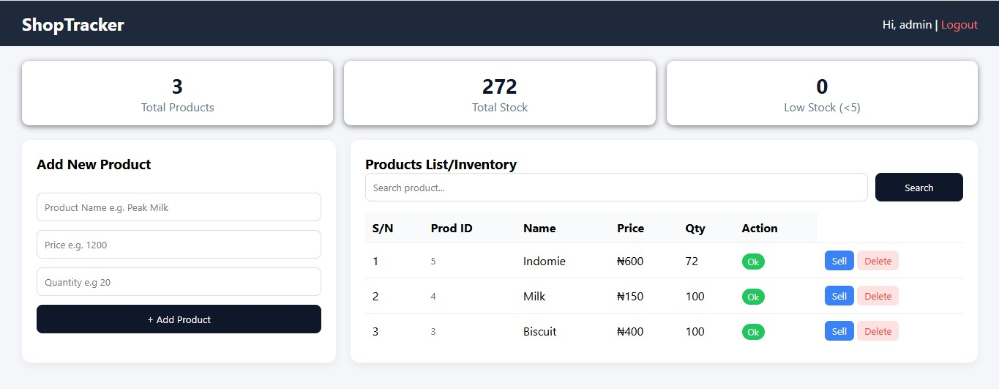

# 📦 ShopTracker - Simple Inventory Management System

**Version:** 1.0.1  
**Author:** [William Adejoh]

## Overview
ShopTracker is a lightweight inventory management system for small retail shops. It allows shop owners to track products, manage stock levels, and record sales in real-time. Built as backend Project of my portfolio.

## Features
- Admin Auth (session)
- CRUD: Add / Sell / Delete products
- Stats: Total Products, Total Stock, Low Stock (<5)
- Search by product name
- Dual tracking: S/N (UI) + Prod ID (DB)
- Low/OK status badges, Responsive grid

  
## Tech Stack 
PHP 8, MySQL, HTML5, CSS3 Grid/Flex

## File Structure & Description

| File | Purpose |
|------|---------|
| `config/db.php` | Central database connection file. Establishes MySQLi connection and handles connection errors. Used by all PHP files. |
| `login.php` | Authentication entry point. Uses `password_verify()` to check hash, `trim()` to sanitize, and `$_SESSION` to persist login. |
| `dashboard.php` | Protected admin panel. Includes session check, CRUD operations (Create, Read, Update, Delete), and stats aggregation using SQL `COUNT()` and `SUM()`. |
| `logout.php` | Destroys session and redirects to login. |
| `style.css` | Single source of styling for maintainability. Contains BEM-like classes for login, stats, cards, and buttons. |
| `README.md` | Project documentation. |

## Screenshot

## Database Schema
**Database Name:** `shop_tracker_db`

**Table: users**
- id INT PK AUTO_INCREMENT
- username VARCHAR(100) UNIQUE
- password VARCHAR(255) - stores bcrypt hash (60 chars)
- role ENUM('admin','staff')

**Table: products**
- id INT PK AUTO_INCREMENT
- name VARCHAR(100)
- price DECIMAL(10,2)
- quantity INT

## Security Implemented
1. Password hashing with `password_hash()` - never stores plain text
2. Prepared statements (`bind_param`) to prevent SQL Injection
3. Session validation on every protected page
4. `intval()` on GET parameters to prevent ID manipulation
5. `htmlspecialchars()` to prevent XSS

## How to Run Locally
1. Start XAMPP Apache & MySQL
2. Import DB or create `shop_tracker_db` and run SQL in `schema.sql`
3. Place project in `htdocs/portfolio/projects/shop-tracker/`
4. Visit `http://localhost/portfolio/projects/shop-tracker/login.php`
5. Login: admin / admin123

## Concept Learned
- Importance of VARCHAR(255) for password hashes
- Session-based authentication flow
- Prepared statements for security

## Future Improvements (v2.0)
- Add sales history table
- Export to Excel/PDF
- Barcode scanning
- Staff cannot delete (role check)

---
Built by **William Adejoh** as part of my web development portfolio.